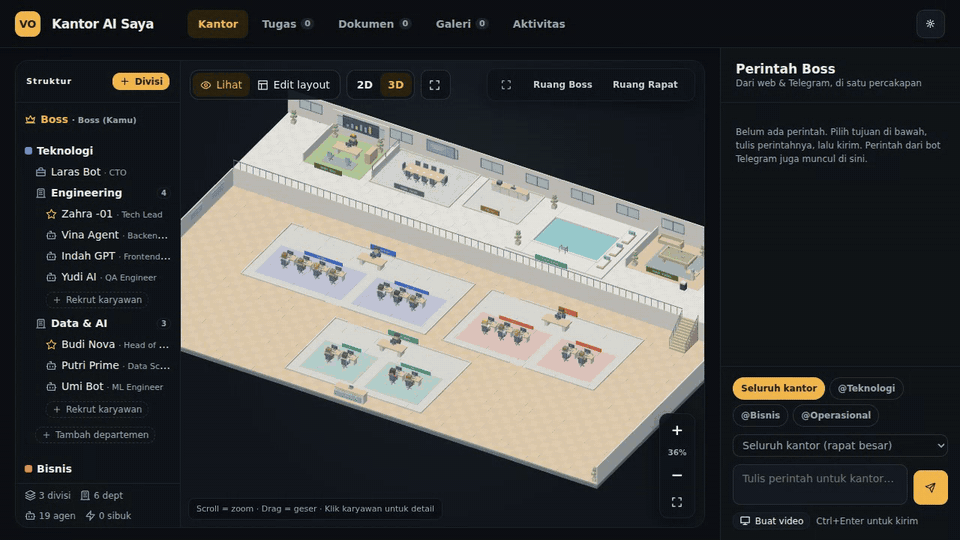

# Visual Office — Kantor Agent AI



**[▶ Coba live demo](https://visual-office.vercel.app)**

- 🤖 **Kantor berisi agent AI**: beri perintah sebagai Boss, lalu Direktur → Ketua Tim → Staf akan briefing, bekerja, dan melapor balik secara berjenjang.
- 📊 **Terhubung ke data bisnis nyata**: agen membaca data aplikasi MiniMarket & Gudang untuk menyusun laporan stok dan penjualan.
- 🎬 **Lebih dari sekadar chat**: render 3D (three.js), perintah lewat bot Telegram, sampai pembuatan video MP4 otomatis dengan Remotion.

Visualisasi kantor **isometrik 2.5D** (gaya pixel ala Habbo) yang karyawannya adalah **agent AI** (ditenagai Gemini, gratis). Kamu bisa mengatur bentuk kantor, menambah **divisi**, **departemen**, merekrut **agen**, dan ada **Boss** yang memberi perintah.

## Fitur

| Fitur | Keterangan |
|---|---|
| **Daftar & masuk** | Halaman login dengan tab **Masuk / Daftar** (email + kata sandi), seperti SimpananMu & Gudang-Document. Akun disimpan di **Upstash Redis** (hash scrypt, maks. 10 percobaan / 15 menit). Semua halaman & API dikunci di sisi server (cookie bertanda tangan + Vercel Middleware). Opsional: `REGISTER_CODE` (kode undangan) atau `ALLOW_REGISTER=false`. |
| **Departemen Gudang ↔ Gudang-Document** | Template departemen **Gudang** (Kepala Gudang, Analis Stok, Admin PO & Penerimaan, Petugas Barang Keluar & Opname). Saat diberi tugas, tim menarik data aplikasi Gudang-Document (stok, PO, GRN, barang keluar, opname, supplier) — **hanya baca** — lalu Gemini mengolahnya menjadi laporan. Tanpa AI, laporan stok kritis & PO tertunda dihitung otomatis dari data. |
| **Divisi Minimarket ↔ MiniMarket** | Template divisi **Minimarket** (Direktur Minimarket + departemen Toko & Penjualan, Persediaan, Keuangan Toko — 8 karyawan siap pakai). Seluruh divisi membaca data aplikasi MiniMarket (penjualan, stok, kas & bank, piutang/hutang, laba rugi) langsung dari database Turso — **hanya baca**. Integrasi juga bisa dipasang ke divisi mana pun lewat **Edit divisi → Integrasi data**. |
| **Data Publik (public-apis)** | Integrasi gratis tanpa API key dari daftar [public-apis](https://github.com/public-apis/public-apis): **Kurs Mata Uang** (Frankfurter), **Hari Libur Nasional** (Nager.Date), **Cuaca** 7 hari (Open-Meteo), atau **Data Publik** (gabungan ketiganya). Pasang di divisi/departemen lewat **Edit → Integrasi data**; data disisipkan ke konteks tugas & chat agen. |
| **Kamu = Boss** | Nama saat mendaftar otomatis menjadi Boss. Kantor, ingatan agen, dan Gudang Dokumen tersimpan **per akun di database**, jadi bisa dibuka dari perangkat mana pun. |
| **Mulai dari kosong** | Kantor baru hanya berisi Ruang Boss, Ruang Rapat, dan Pantry — cocok untuk demo menambah divisi & karyawan. Tombol **Contoh** memuat kantor contoh, **Kosongkan** mulai dari nol lagi. |
| **Hierarki kantor** | Kamu (Boss) → Direktur Divisi → Ketua Tim (lead) → Anggota. Setiap level briefing ke atasan, bekerja di mejanya, lalu melapor balik. |
| **Divisi & Departemen** | Tambah / edit / hapus divisi (zona berwarna) dan departemen (ruangan dengan meja otomatis). |
| **Karakter 3D** | Karyawan memakai 14 model 3D dari `office_cast_lineup.glb` (dipra-render menjadi sprite: depan/belakang/samping, berjalan, duduk, mengetik, sorak). Pilih karakter per karyawan di form **Edit → Karakter 3D** (default otomatis sesuai gaya pakaian). |
| **Tampilan Studio (satu-satunya tampilan)** | Bentuk gedung mengikuti `office_ai_expanded_v2.glb`: kamera depan **simetris** (perspektif satu titik, dinding kiri & kanan sama), pelat fondasi tebal, lantai ubin krem kotak-kotak, meja resepsionis **OFFICE AI** di depan, baris divisi di tengah lantai. |
| **Detail Studio** | Kantor **2 lantai** yang terang dengan kamera depan (3D): ruang Boss, rapat, pantry, kolam & biliar di **lantai mezanin** berpagar kaca, **tangga kayu** turun ke lantai 1; setiap **divisi berada dalam ruangan bersekat kaca** (rangka putih, list warna divisi, pintu depan & belakang, lantai sedikit berwarna divisi); departemen sebagai zona lantai berwarna pastel dengan sekat rendah & papan nama (nama · jumlah orang), lantai kayu terang, dinding putih berjendela, pintu & rak buku. Karyawan berjalan naik-turun tangga. |
| **Tampilan Penthouse** | Kantor mewah malam hari: lantai panel gelap bergaris cahaya cyan (sama seperti Ruang Boss), dinding kaca dengan pemandangan gedung kota yang menyala diselingi pilar kayu berlampu, ruang rapat berdinding kaca dengan TV yang menampilkan tugas yang sedang berjalan, layar grafik di tiap departemen, meja walnut dengan dua monitor, karpet biru tua, **kolam renang** beranimasi dengan kursi berjemur & payung, lampu LED di tepi gedung, langit berbintang. Label nama pil gelap di kaki karyawan, balon putih berikon, lencana merah **!** saat karyawan menunggu Boss. **Tab ruangan** di atas kanvas untuk langsung terbang ke ruangan/divisi. |
| **Papan tugas departemen** | Layar besar di dinding tiap departemen (tema Penthouse) menampilkan **daftar permintaan tugas dari atasan** untuk departemen itu: judul, status (Briefing / Rapat / Dikerjakan / Selesai / Gagal), dan progres tim; tugas aktif di atas. |
| **Meja manager & posisi atasan** | Ketua tim (manager) mendapat **meja L khusus**: lebih lebar dengan list aksen, monitor besar + monitor samping, lampu meja, papan nama, karpet kecil, dan kursi eksekutif bersandaran tinggi, berbeda dari meja staf. Posisi meja direktur tiap divisi bisa diatur **Kiri / Tengah / Kanan** di **Edit Divisi** (Finance Division otomatis di kanan). |
| **Ruang Boss berteknologi** | Meja kaca gelap di **sisi kanan** ruangan dengan strip LED cyan berdenyut dan hanya **laptop** di atasnya, **video wall** real-time di dinding (tugas tuntas, agen sibuk, tugas yang sedang berjalan, jam & tanggal, status AI), sofa tamu dengan meja kopi kaca, meja meeting bundar kecil dengan kursi tub, tanaman, server rack berkedip, lantai panel gelap dengan garis cahaya, dan cincin cahaya di sekitar meja. |
| **Ruang Biliar** | Fasilitas baru: meja biliar dengan kain hijau, lubang, bola (bola putih bergulir pelan), rak stik di dinding, dan lampu gantung. Karyawan sesekali main biliar saat santai. Tambah lewat **Edit Layout → + Biliar** (kantor lama mendapat satu otomatis). |
| **Tata ruang open plan (default)** | Setiap divisi menjadi **satu ruangan** minimalis: direktur (atasan) duduk di meja eksekutif di depan-tengah menghadap timnya, departemen ditandai karpet/kluster meja tanpa dinding pemisah. Gaya lama (ruang berdinding per departemen) bisa dipilih di **Edit Layout → Tata ruang**. |
| **Tombol zoom + / −** | Di pojok kanan bawah kanvas: **+** perbesar, **−** perkecil (zoom halus di tengah layar), angka persen / ikon kotak = tampilkan seluruh kantor. Pintasan keyboard `+` / `-`; scroll mouse tetap bisa dipakai. |
| **Tombol 2D / 3D** | Di bar atas: **3D** = isometrik, **2D** = denah dari atas (gaya peta RPG). Berlaku untuk semua tema; data, posisi, klik karyawan & Edit Layout tetap bekerja. Pintasan keyboard: `2` / `3`. |
| **Kamera menghadap depan (perspektif)** | Tampilan 3D melihat gedung lurus dari depan dengan **perspektif sungguhan** (mata kamera tetap di depan-atas gedung, sudut 36°): dinding samping menyempit ke belakang, yang dekat tampak lebih besar. Label, klik karyawan & Edit Layout memakai proyeksi perspektif yang sama; kamera bisa di-zoom (tombol + / −, scroll) dan digeser (drag). Label nama yang bertabrakan otomatis digeser ke baris lain. |
| **Tur ruangan** | Navigator **‹ Seluruh kantor ›** di pojok kanan atas kantor: kamera meluncur & zoom halus (dengan sedikit motion blur) ke tiap divisi, departemennya, lalu fasilitas, disertai judul ruangan. **Klik ruangan/zona di kantor** (atau di Struktur) juga langsung zoom ke sana dan navigator ikut pindah, jadi ‹ › berlanjut ke ruangan sebelahnya. Klik nama untuk lompat langsung, **AUTO** untuk keliling sendiri tiap ± 5 detik (berhenti saat kantor disentuh). Pintasan: `←` / `→`, `A`. |
| **Tampilan 3D dari aset GLB** | Mode 3D kini digambar dengan three.js (WebGL) langsung dari model: gedung `assets/office/office_empty.glb`, Ruang Boss `boss_room.glb`, Ruang Biliar `billiard_room.glb`, Kolam `swimming_pool.glb`; meja kerja, kursi, meja direktur, meja rapat, pantry, lounge, resepsionis, server & tanaman diambil dari `office_ai_expanded_v2.glb`; karakter dari `office_cast_lineup.glb` (berjalan, duduk, mengetik). Denah tetap mengikuti data (1 tile = 1 m), jadi divisi/karyawan baru langsung mendapat zona & meja 3D. Bila WebGL tidak tersedia, otomatis kembali ke tampilan kanvas lama. |
| **Grafis 3D HD** | Material PBR + cahaya lingkungan, **bayangan matahari lembut**, **ambient occlusion (GTAO)** di sudut & kolong meja, dan render resolusi tinggi. Atur di menu ⚙ → **Grafis 3D**: HD / Sedang (tanpa AO) / Hemat (tanpa bayangan). Pilihan disimpan per perangkat; bila frame terlalu lambat, kualitas turun otomatis satu tingkat. |
| **Properti kantor** | Lantai bawah papan kayu hangat; tiap departemen beralas **karpet pastel bermotif** (segitiga & titik) warna divisinya dengan list di tepi; meja putih dengan **dua monitor biru**; dinding belakang lantai bawah dihias **poster, rak buku, pintu, dispenser air & sticky notes**; tanaman semak bulat di sudut zona; **label ruangan melayang** (pil gelap, teks mono berwarna, mis. `DIGITAL MARKETING · 5`) yang selalu tajam & terbaca di zoom berapa pun. |
| **Dinding kaca ruangan** | Tiap zona divisi dikelilingi **dinding kaca berangka gelap** setinggi 2,2 m (pintu depan & belakang); tiap departemen diberi **sekat kaca rendah** (1 m) di tepi karpet dengan celah masuk di depan. Kantor baru & kantor contoh memakai **Lounge** sebagai pengganti Kolam Renang (kolam tetap bisa ditambah lewat Edit layout). |
| **Lantai atas** | Lantai papan kayu terang, **pagar balkon kaca** bertiang gelap, ruangan bersekat **kaca berangka hitam** (Ruang Boss & Rapat juga di depan, dengan celah pintu); Ruang Rapat berkarpet dengan **dinding panel kayu berlis emas**, Pantry berubin krem dengan backsplash mint & rak, Lounge berkarpet dengan dinding sage; dinding gedung putih & jendela biru langit. |
| **Dashboard agen** | Klik karyawan → kamera terbang mendekat dan muncul kartu dashboard di samping karakternya: status langsung, model, departemen, **tugas selesai, tingkat sukses, antrean, dokumen**, tugas yang sedang dikerjakan (dengan progres), hasil kerja terakhir, serta tombol **Beri tugas**, **Chat**, **Edit**, **Lihat dokumen**. Detail (instruksi, ingatan, jadikan lead, hapus) ada di bagian *Detail & pengaturan*. Tutup dengan ✕ atau `Esc`. |
| **Tampilan Kantor Klasik** | Kantor pixel isometrik klasik: lantai ubin lavender, dinding abu berjendela dengan poster, meja krem berlaci dengan monitor krem & tempat sampah, kursi biru, sekat kubikel kaca berbingkai biru, rak kaca biru, pohon bonsai, sofa biru di karpet hijau, mesin fotokopi, karpet biru di Ruang Boss; karyawan berupa manusia. |
| **Tampilan Robot** | Karyawan berupa robot imut (kepala putih dengan layar wajah, lengan & kaki oranye; aksesori sesuai jabatan seperti headphone atau gulungan film), pulau kerja putih yang terangkat, aksen biru kobalt & koral, label pil dengan titik status dan chip aktivitas oranye. |
| **Tampilan Modern** | Kantor terbuka yang terang: lantai putih, sekat rendah & tiang tipis, meja putih, nama tim dicat di lantai, dan kartu nama melayang (nama + jabatan) di atas tiap karyawan. Tombol tema di bar atas berganti Studio → Penthouse → Kantor Klasik → Robot → Modern → **Pixel** (gelap, gaya Habbo). |
| **Chat dengan karyawan** | Klik karyawan → panel chat. Jawaban dari Gemini sesuai persona, ingatan, dan dokumen relevan; karyawan departemen Gudang menjawab dari data Gudang-Document. Riwayat chat tersimpan per karyawan. |
| **Karakter gaya Habbo** | Karyawan isometrik dengan gaya pakaian (jas & dasi, kemeja & dasi, cardigan & rok), 6 model rambut, kacamata, kumis, dan warna yang bisa diatur. Boss memakai mahkota. |
| **Agen AI** | Nama, jabatan, model (**Gemini Flash / Flash-Lite / Pro** — gratis; Claude opsional), *system prompt* / kepribadian, warna baju-rambut-kulit, pindah departemen, jadikan lead. |
| **Editor layout** | Geser ruangan & zona, ubah ukuran (pojok kanan-bawah), tambah Ruang Rapat / Pantry / Lounge, taruh furnitur (tanaman, sofa, rak buku, whiteboard, dispenser, printer, server, arcade), ganti lantai, ukuran peta, **Tata Otomatis**. |
| **Perintah Boss** | Beri tugas ke seluruh kantor (ada rapat besar di ruang rapat), satu divisi, satu tim, atau satu agen. Lihat progres & hasil tiap agen. |
| **Mode simulasi** | Jalan tanpa internet/API: karyawan ngopi, ngobrol, brainstorm, dan mengerjakan tugas secara simulasi. |
| **Mode AI nyata** | Setiap agen benar-benar memanggil **Gemini** (free tier) dengan persona & jabatannya; lead & direktur merangkum laporan timnya, Boss membuat ringkasan eksekutif. Panggilan diantrekan sesuai batas per menit & otomatis dicoba ulang saat kena rate limit. |
| **Simpanan (ingatan agen)** | Tiap agen mengingat 6 hasil kerja terakhirnya dan memakainya sebagai konteks di tugas berikutnya. Lihat / hapus di Inspector. |
| **Gudang Dokumen** | Semua laporan & hasil kerja tersimpan otomatis. Unggah file `.txt`/`.md` (SOP, panduan brand, data produk) — agen otomatis membaca dokumen yang relevan dengan tugasnya. Bisa dicari, diunduh sebagai **PDF** atau `.md`, dihapus. Laporan tugas juga bisa diunduh PDF langsung dari detail tugas. |
| **Live Claude Code** | Sesi Claude Code-mu muncul sebagai karyawan: menerima prompt dari Boss, memakai tool (Edit, Bash, …) di mejanya, lalu melapor saat selesai. |
| **Simpan** | Tersimpan otomatis ke database per akun (tiap ±8 detik) + cache di browser, plus Export / Import file JSON. |

## Cara menjalankan

### Opsi A — paling cepat (offline, mode simulasi)
Buka `index.html` langsung di browser. Selesai.

### Opsi B — server lokal (mode AI + live Claude Code)
Butuh Node.js 20.12+.

```bash
npm install
cp .env.example .env        # isi GEMINI_API_KEY (gratis: https://aistudio.google.com/apikey)
npm start                   # → http://localhost:4317
```

Lalu centang **Mode AI nyata** di bar atas. Tanpa API key, aplikasi tetap jalan dalam mode simulasi.

### Opsi C — deploy ke Vercel
Proyek ini siap Vercel tanpa konfigurasi build: file statis + Vercel Functions di `api/` (`api/health.js`, `api/run.js`).

1. Di [vercel.com/new](https://vercel.com/new) → **Import** repo `visual-office` dari GitHub.
2. **Framework Preset:** `Other` (sudah dipaksa lewat `vercel.json`). Build Command & Output Directory biarkan default.
3. **Environment Variables:** tambahkan `GEMINI_API_KEY` = kunci dari Google AI Studio (centang Production & Preview).
4. **Database akun:** project → **Storage → Create Database → Upstash for Redis → Connect**
   (bisa juga pakai database Upstash yang sama dengan SimpananMu; data dipisah dengan prefix `visualoffice:`).
   `KV_REST_API_URL` & `KV_REST_API_TOKEN` terisi otomatis.
   - opsional `REGISTER_CODE` = kode undangan yang wajib diisi saat daftar
   - opsional `ALLOW_REGISTER=false` = tutup pendaftaran setelah akunmu dibuat
5. Klik **Deploy** (atau **Redeploy** bila env/database ditambahkan setelah deploy). Buka URL-nya → pill di bar atas harus menunjukkan **Gemini siap**.
6. Pilih branch yang dideploy: *Production Branch* default `main`; jika belum ada `main`, set di
   **Settings → Git → Production Branch** atau merge branch ini ke `main`.

Catatan Vercel:
- Fitur **Live Claude Code** (hooks) hanya tersedia di server lokal, karena butuh koneksi SSE yang terus hidup.
- Tanpa database (dan tanpa `APP_USERNAME`/`APP_PASSWORD`), deployment Vercel **terkunci total** — halaman login menampilkan pesan setup.
- Login melindungi halaman dan `/api/run`. Karena siapa pun bisa mendaftar, pakai `REGISTER_CODE` atau `ALLOW_REGISTER=false` bila kuota Gemini tidak ingin dipakai orang lain.
- Tanpa database, kamu tetap bisa memakai akun tetap lewat `APP_USERNAME` + `APP_PASSWORD` (tanpa fitur daftar; data hanya di browser).

### Model & kuota gratis
| Variabel | Default | Keterangan |
|---|---|---|
| `GEMINI_API_KEY` | – | Wajib untuk mode AI. |
| `GEMINI_MODEL` | `gemini-flash-latest` | Model untuk agen yang modelnya tidak dikenali. Alias `*-latest` selalu menunjuk versi terbaru. |
| `LLM_MAX_OUTPUT_TOKENS` | `2048` | Batas token jawaban per agen. |
| `ANTHROPIC_API_KEY` | – | Opsional: agen yang memilih model Claude memakai Claude. |

Free tier Gemini dibatasi per menit & per hari. Atur **batas panggilan/menit** di bar atas (default 10/mnt). Satu tugas
"Seluruh kantor" = 1 panggilan per agen + ringkasan per lead/direktur/Boss (±30 panggilan di kantor contoh) — untuk hemat
kuota, beri tugas per tim atau pakai model Flash-Lite.

### Hubungkan Claude Code (live)
1. Jalankan `npm start`.
2. Salin isi `hooks/settings.example.json` ke `~/.claude/settings.json` (atau `.claude/settings.json` di proyekmu),
   ganti `/PATH/KE/visual-office` dengan lokasi folder ini.
3. Pakai Claude Code seperti biasa — setiap sesi muncul di divisi **Live · Claude Code**.

Hook tidak pernah memblokir Claude Code (timeout 1,5 detik, selalu exit 0). Ubah alamat server dengan `VISUAL_OFFICE_URL`.

## Kontrol

| Aksi | Cara |
|---|---|
| Zoom | Scroll mouse |
| Geser kamera | Drag area kosong / klik kanan-drag |
| Pilih karyawan / ruangan | Klik (atau klik di pohon organisasi) |
| Edit karyawan | Klik 2× pada karyawan |
| Mode edit layout | Tombol **Edit Layout** atau tombol `E` |
| Lihat seluruh kantor | `F` atau tombol ⤢ |
| Hapus yang dipilih | `Delete` |
| Kirim tugas cepat | `Ctrl/Cmd + Enter` di kotak perintah |

## Struktur kode

```
index.html          UI utama
css/style.css       tampilan
js/model.js         data organisasi, layout, ingatan agen, gudang dokumen, simpan/muat
js/sim.js           grid jalan, pathfinding (BFS), perilaku karyawan
js/tasks.js         alur tugas hierarkis + pemetaan event live Claude Code
js/icons.js         ikon SVG (pengganti emoji) untuk HTML & canvas
js/ai.js            klien ke backend (/api/run, /api/events) + antrean rate limit
js/render.js        renderer isometrik 2.5D: lantai, dinding, meja, furnitur, karakter gaya Habbo, balon chat
js/ui.js            panel organisasi, inspector, daftar tugas, dialog
js/main.js          bootstrap, game loop, kamera & editor
lib/llm.js          lapisan LLM bersama (Gemini / Claude), dipakai lokal & Vercel
api/                Vercel Functions: health, run, login, register, logout, me, office, gudang
middleware.js       Vercel Routing Middleware: wajib login untuk semua halaman
lib/auth.js         sesi login (HMAC, Web Crypto) dipakai middleware, functions & server lokal
lib/accounts.js     daftar/masuk email + kata sandi (scrypt) di Upstash Redis
lib/db.js           klien Upstash Redis REST (tanpa SDK)
lib/minimarket.js   baca data MiniMarket (Turso/libSQL, hanya baca) untuk divisi Minimarket
js/integrations.js  kerangka integrasi data (divisi/departemen ↔ aplikasi lain)
js/minimarket.js    template divisi Minimarket + data sebagai konteks tugas agen
lib/gudang.js       baca data Gudang-Document (hanya baca) untuk departemen Gudang
js/gudang.js        template departemen Gudang + data sebagai konteks tugas agen
js/cloud.js         sinkron kantor & dokumen ke database per akun
js/chat.js          panel chat dengan karyawan (Gemini)
js/pdf.js           ekspor dokumen/laporan ke PDF (jsPDF di js/vendor, dimuat saat dibutuhkan)
login.html          halaman login
local/server.js     server lokal: statis + /api/run + jembatan event (SSE)
vercel.json         konfigurasi Vercel
hooks/              hook Claude Code → Visual Office
```

## API server

| Endpoint | Fungsi |
|---|---|
| `GET /api/health` | Status mode AI & provider |
| `POST /api/run` `{model, system, prompt}` | Jalankan satu agen, respons streaming SSE (`text` / `done` / `error`) |
| `POST /api/event` | Kirim event (format hook Claude Code: `hook_event_name`, `session_id`, `tool_name`, …) |
| `GET /api/events` | Langganan event live (SSE) |

`/api/event` & `/api/events` hanya ada di server lokal. Server lokal mendengarkan `127.0.0.1` secara default (ubah dengan `HOST=0.0.0.0` bila perlu — hati-hati, `/api/run` memakai API key-mu).

## Integrasi Gudang-Document

Departemen dengan template **Gudang** membaca data aplikasi [Gudang-Document](https://github.com/RifqiFachruradzi/Gudang-Document)
langsung dari database Upstash yang sama (kunci `gudang:*`), **hanya baca** — tidak ada data gudang yang diubah.

1. Pastikan project Visual Office terhubung ke database Upstash yang sama dengan Gudang-Document (Vercel → Storage, prefix `KV`).
2. Tambah departemen → Template **Gudang — terhubung ke Gudang-Document**.
3. Klik departemen Gudang → **Tes koneksi** untuk melihat jumlah barang, PO, dan GRN yang terbaca.
4. Beri tugas ke departemen Gudang, misalnya "Buat laporan stok kritis dan PO yang belum selesai".

Data yang diambil: stok (jumlah terbaru, minimum, lokasi), purchase order beserta sisa barang, penerimaan barang (GRN),
barang keluar, stok opname, dan supplier. Tanda tangan, foto, dan akun pengguna Gudang-Document tidak diambil.

## Integrasi MiniMarket

Divisi dengan template **Minimarket** membaca data aplikasi [MiniMarket](https://github.com/RifqiFachruradzi/MIniMarket-APP)
langsung dari database Turso/libSQL-nya, **hanya baca** (semua query dijalankan dalam transaksi `read`).
Semua departemen dan direktur di divisi itu mendapat data yang sama; departemen yang punya integrasi sendiri (mis. Gudang) tetap memakai integrasinya.

1. Di project Vercel **Visual Office** → Settings → Environment Variables, tambahkan:
   - `MINIMARKET_DATABASE_URL` = URL database Turso MiniMarket (`libsql://…turso.io`, sama dengan `TURSO_DATABASE_URL` di project MiniMarket)
   - `MINIMARKET_AUTH_TOKEN` = token database. Disarankan token **read-only**: `turso db tokens create <nama-db> --read-only`
   
   Lalu **Redeploy**.
2. Klik **+ Divisi** → Template **Minimarket — terhubung ke aplikasi MiniMarket**.
3. Klik divisi Minimarket → **Tes koneksi** (menampilkan jumlah produk, omzet bulan ini, tanggal data).
4. Beri tugas ke divisi Minimarket, misalnya "Buat laporan kinerja toko bulan ini dan rencana pemesanan ulang".

Data yang diambil: ringkasan penjualan hari ini & bulan ini, penjualan harian 30 hari, metode bayar, produk terlaris & tidak laku,
stok semua produk (status habis/menipis), nilai persediaan per kategori, saldo kas & bank, piutang & hutang belum lunas,
penerimaan & pengeluaran barang, stock opname, dan laba rugi bulan berjalan. Akun pengguna MiniMarket tidak diambil.

## Integrasi Data Publik (public-apis)

API gratis tanpa key dari [public-apis/public-apis](https://github.com/public-apis/public-apis), dibaca lewat server (`/api/public`), di-cache 10 menit, **hanya baca**:

| Integrasi | Sumber | Isi |
|---|---|---|
| Kurs Mata Uang | [Frankfurter](https://frankfurter.dev) (kurs ECB) | 1 USD/EUR/SGD/MYR/CNY/JPY/AUD/GBP/SAR = Rp…, tren USD/IDR 30 hari |
| Hari Libur Nasional | [Nager.Date](https://date.nager.at) | Libur nasional Indonesia tahun ini & depan, berapa hari lagi |
| Cuaca | [Open-Meteo](https://open-meteo.com) | Cuaca sekarang + prakiraan 7 hari (suhu, hujan, peluang hujan) |
| Data Publik | gabungan | Ketiganya sekaligus (bagian yang gagal dilaporkan, sisanya tetap dipakai) |

Cara pakai: klik divisi/departemen → **Edit** → **Integrasi data** → pilih salah satu → **Tes koneksi**. Kota untuk cuaca diisi di form yang sama
(default Jakarta, atau env `WEATHER_CITY`). Tidak perlu API key atau pengaturan Vercel tambahan.

## Integrasi 9router (AI dari VPS sendiri)

Visual Office bisa memakai [9router](https://github.com/decolua/9router) atau router lain yang kompatibel OpenAI
(`/v1/chat/completions`, streaming) sebagai otak karyawan AI. Isi di Vercel → Settings → Environment Variables, lalu **Redeploy**:

| Variabel | Contoh | Keterangan |
|---|---|---|
| `NINEROUTER_BASE_URL` | `https://38-9-46-94.sslip.io/v1` | URL publik 9router (HTTPS). Jangan `127.0.0.1` — Vercel tidak bisa menjangkau localhost VPS |
| `NINEROUTER_API_KEY` | `sk-…` | Key dari dashboard 9router |
| `NINEROUTER_MODEL` | `cc/claude-sonnet-4-5` | Model/combo default di 9router |
| `AI_PROVIDER` | `gemini` | Opsional: paksa kembali ke Gemini |

Bila 9router diisi, **semua agen** memakai 9router (pil AI di bar atas menampilkan "9router"). Model khusus per agen:
pilih model `9router` di form agen, atau tulis model `9router:<nama-model>` lewat Export/Import JSON.

## Perintah lewat Telegram

Boss bisa memberi perintah dari bot Telegram; laporan akhirnya dikirim balik ke chat.

1. Buat bot baru di **@BotFather** (`/newbot`) dan salin tokennya. Pakai bot khusus Visual Office: satu bot tidak bisa dipakai Hermes dan Visual Office bersamaan.
2. Vercel → *Settings → Environment Variables* → `TELEGRAM_BOT_TOKEN` = token bot (opsional `TELEGRAM_WEBHOOK_SECRET`), lalu **Redeploy**.
3. Buka Visual Office → tombol **Telegram** (ikon pesawat kertas) → **Pasang webhook** → **Hubungkan chat Telegram** → klik tautan `t.me/<bot>?start=KODE` (atau kirim `/link KODE` ke bot).

Cara pakai di Telegram:

| Pesan | Hasil |
|---|---|
| `Buat rencana promosi bulan depan` | dikerjakan seluruh kantor |
| `@Finance buat ringkasan arus kas` | dikerjakan divisi / departemen / karyawan bernama Finance |
| `@Hadi Prime cek progres sprint` atau `@HadiPrime …` | dikerjakan satu karyawan saja (nama depan saja cukup bila tidak ada yang kembar; bila kembar, bot menanyakan yang dimaksud) |
| `/tim` | daftar divisi & karyawan beserta nama `@` untuk disalin |
| `/status` | 5 tugas terakhir |
| `/divisi Logistik` | divisi baru + direktur |
| `/divisi Logistik: Gudang, Pengiriman` | divisi baru sekaligus departemennya (tiap departemen: ketua tim + 2 staf) |
| `/departemen @Logistik Armada` · `… Armada 4` | departemen baru di divisi (ketua + 2 staf, atau jumlah staf sesuai angka) · nama berspasi: `/departemen Divisi Logistik: Armada` |
| `/rekrut @Gudang Admin Stok` | karyawan baru di departemen |
| `/help`, `/unlink` | bantuan, putuskan chat |

- **Kantor sedang dibuka** (tab terlihat): perintah masuk antrean, dikerjakan seluruh hierarki (briefing, kerja, laporan, Gudang Dokumen) dengan animasi, lalu laporan dikirim ke Telegram.
- **Kantor tidak dibuka**: perintah langsung dikerjakan AI di server atas nama divisi/karyawan tujuan, laporan disimpan ke Gudang Dokumen dan dikirim ke Telegram; saat kantor dibuka, tugasnya muncul di daftar Tugas.
- Perubahan struktur: bila ada tab kantor terbuka, perubahan diterapkan oleh tab itu (lalu tersimpan seperti biasa); bila tidak, server mengubah data kantor di database memakai `js/model.js` yang sama, lalu denah ditata ulang otomatis. Tab lama yang dibuka sebelum perubahan tidak bisa menimpanya (server menolak simpanan versi lama dan tab dimuat ulang).
- Keamanan: webhook diverifikasi dengan secret token; hanya chat yang sudah ditautkan (kode sekali pakai, 15 menit) yang bisa memberi perintah.
- Endpoint: `/api/telegram` — dari Telegram (dikenali lewat header secret token) dan dari aplikasi (wajib login). Satu endpoint saja karena paket Hobby Vercel membatasi jumlah function. Butuh database Upstash.

## Sumber AI: 9router di VPS, Gemini sebagai cadangan

Semua panggilan AI (dari browser, Telegram, dan pembuatan naskah video) lewat server Vercel:
**9router di VPS** (`NINEROUTER_BASE_URL` + `NINEROUTER_API_KEY`) dipakai lebih dulu; bila 9router tidak menjawab
(error 5xx / jaringan / tidak tersambung dalam 12 detik), otomatis pindah ke **Gemini** (`GEMINI_API_KEY`).
Tidak ada pengaturan sumber AI di aplikasi. Mode AI bisa dimatikan dari menu ⚙ (kembali ke simulasi).

## Programmatic video (naskah → template → MP4 → Galeri & jadwal tayang)

Video dibuat **lewat kode**, bukan diedit manual — seperti video explainer "ChatGPT 2,9 Wh vs Google 0,3 Wh".

0. **Alur cek naskah** (bawaan dari web): AI menulis draf → video berstatus **Perlu dicek** di Galeri → Boss mengedit tiap adegan (template, teks, poin, angka, aset, durasi, narasi, animasi AI; urutan/tambah/hapus) → **Render video** → Remotion merender persis sesuai naskah itu. Perintah dari Telegram langsung dirender.
1. **Beri tugas video**: tulis di *Perintah Boss* (mis. `buat video penjelasan biaya listrik AI`), klik **🎬 Buat video**, atau dari Telegram `/video …` / `@Sosmed buat video …` (bisa kirim foto + caption `/video …`).
2. **Tim mengerjakan**: divisi Sosmed/Marketing/Konten (dicari otomatis dari nama divisi/departemen) briefing, riset & menulis naskah kasar seperti tugas biasa (animasi kantor).
3. **Naskah terstruktur**: AI menyusun storyboard JSON — tiap adegan memakai satu **template** + isinya.
4. **Render MP4**:
   - **Server video (Remotion di VPS)**, bila worker aktif: 5 paket visual, narasi suara + subtitle kata per kata, musik latar, dan foto/video stok — lihat bagian berikut. Bisa juga saat Visual Office tidak dibuka (permintaan dari Telegram).
   - **Cadangan di browser** (WebCodecs + mp4-muxer): Chrome/Edge memakai H.264, browser tanpa H.264 memakai VP9. Tanpa narasi/musik/foto stok, dan paket visual hanya mengubah warna.
5. **Galeri** (tab 🎬 Galeri): putar, unduh, salin caption, kirim ke Telegram, atur **jadwal tayang** & platform (YouTube, TikTok, Instagram, Facebook, Threads). Saat jadwal tiba, Visual Office mengingatkan di aplikasi & Telegram (lengkap dengan file videonya); unggahan ke platform dilakukan manual.

**Template** (`js/videoboard.js`, dipakai browser, server & worker): `title` (judul pembuka), `media` (foto/video stok layar penuh), `stat` (angka besar menghitung naik), `compare` (grafik batang + badge "≈ 9,7×"), `bullets`, `steps`, `quote`, `countdown`, `versus` (mitos vs fakta), `image` (foto produk), `price`, `cta`. **Gaya**: explainer, tips, iklan, berita, perbandingan, teaser. **Format**: 9:16 (TikTok/Reels/Shorts) & 16:9 (YouTube). Tanpa Mode AI, naskah memakai templat bawaan dari brief.

### Server video: Remotion di VPS (paket visual, narasi, subtitle, musik, foto stok)

Supaya video tidak terasa "itu-itu saja", worker di `remotion/` merender naskah yang sama dengan:

| | |
|---|---|
| **Paket visual** (dipilih AI sesuai topik, atau dipilih manual) | **Bold** (gradien, teks memantul), **Minimalis** (bersih, naik halus), **Neon** (grid neon, efek glitch), **Editorial** (serif majalah, blok warna, wipe), **Playful** (pastel, stiker, confetti). Tiap paket punya font, latar, animasi teks, kartu, transisi, progres & gaya subtitle sendiri. |
| **Narasi suara** | Tiap adegan punya `narration`; dibacakan Gemini TTS (pakai `GEMINI_API_KEY` di Vercel, suara perempuan/laki-laki). Panjang adegan menyesuaikan narasi (dipotong di jeda hening). |
| **Subtitle** | Kata per kata, kata yang sedang diucapkan disorot (gaya mengikuti paket). |
| **Musik latar** | Upbeat / tenang / dramatis — disintesis dari kode (bebas royalti), otomatis diredam saat narasi. |
| **Foto/video stok** | Kata kunci `media` per adegan dicari di **Pixabay** (gratis; isi `PIXABAY_API_KEY` di VPS) atau Pexels (`PEXELS_API_KEY`). **Aset dari Boss**: di dialog Buat video bisa unggah beberapa foto & video sekaligus (maks. 8, ≤ 50 MB per file); AI menunjuk nomor aset per adegan dan semua aset pasti tampil (foto dari Telegram juga didukung). |

**Tingkat 2 — animasi yang kodenya ditulis AI** (opsi *Animasi: Kreatif* di dialog Buat video, bawaan aktif): AI menandai 1–2 adegan terpenting dengan `"custom": "ide animasi"`. Worker meminta AI (lewat `/api/office?render=llm` → 9router VPS → Gemini) menulis **komponen Remotion (JSX) khusus** untuk adegan itu, lalu memeriksanya: aturan keamanan (hanya `react`/`remotion`, tanpa jaringan/`eval`), sintaks (esbuild), bundel, dan render cuplikan di 3 titik waktu (error / layar kosong). Gagal → pesan error dikirim balik ke AI untuk diperbaiki (maks. 3 putaran); tetap gagal → adegan memakai template biasa, sehingga video tidak pernah gagal karena kode AI. Kode AI hanya berjalan di Chrome headless di dalam kontainer. Menambah ±1–3 menit per video.

Alur: Visual Office menyusun naskah → `/api/office?render=enqueue` (antrean di Upstash) → worker di VPS mengambil job, menyiapkan bahan, merender MP4 H.264 + thumbnail → mengunggah ke Vercel Blob → Visual Office memasukkannya ke Galeri & mengirim ke Telegram. Worker yang menghubungi Visual Office, jadi VPS **tidak butuh domain atau port terbuka**. Bila worker mati, video otomatis dirender di browser.

**Pasang di VPS** (Rocky/Alma 8–9 atau Debian/Ubuntu; 2 core / 2 GB cukup — swap 3 GB dibuat otomatis). Worker berjalan di kontainer Podman (compositor Remotion butuh glibc baru), terpisah dari layanan lain seperti 9router:

```bash
curl -fsSL https://raw.githubusercontent.com/RifqiFachruradzi/visual-office/main/remotion/install-vps.sh | sudo bash
```

Di akhir, skrip menampilkan `RENDER_WORKER_SECRET` → tambahkan di Vercel (Environment Variables) lalu **Redeploy**. Opsional: daftar gratis di [pixabay.com](https://pixabay.com/accounts/register/), ambil kunci di [pixabay.com/api/docs](https://pixabay.com/api/docs/), isi `PIXABAY_API_KEY` di `/etc/visual-office-worker.env`, lalu `systemctl restart visual-office-worker` (Pexels juga didukung lewat `PEXELS_API_KEY`). Log: `journalctl -u visual-office-worker -f`. Jalankan ulang perintah instalasi untuk memperbarui.

Tes tampilan tanpa server: `cd remotion && npm install && node worker.mjs --test all --still --captions` (gambar per adegan di `remotion/out/`). Lisensi Remotion: gratis untuk perorangan & perusahaan ≤ 3 karyawan.

### Penyimpanan file (video, PDF, gambar) — Vercel Blob

Supaya file bisa dibuka dari perangkat mana pun dan dikirim ke Telegram:
Vercel → project → **Storage** → **Create** → **Blob** (akses **Public**) → **Connect** ke project → **Redeploy**. Vercel kini menyambungkan lewat **OIDC** (variabel `BLOB_STORE_ID` + `BLOB_WEBHOOK_PUBLIC_KEY`, token per request) — didukung otomatis memakai upload *presigned*; `BLOB_READ_WRITE_TOKEN` lama juga tetap didukung bila ada.

- Browser mengunggah langsung ke Blob (handshake lewat `/api/office?files=token`), jadi file sampai 50 MB tidak terbentur batas 4,5 MB request Vercel. Bot Telegram mengirim file ≤ 50 MB (MP4 → video, gambar → foto, lainnya → dokumen).
- Gudang Dokumen: **Unggah** file apa pun (teks → pengetahuan agen; PDF/video/gambar → disimpan), pratinjau, unduh, **Kirim ke Telegram**; laporan teks bisa dikirim sebagai PDF.
- Tanpa Blob: di Vercel file hanya bisa diunduh di browser yang membuatnya; di server lokal (`npm start`) file disimpan di folder sementara dan disajikan dari `/files/…`.
